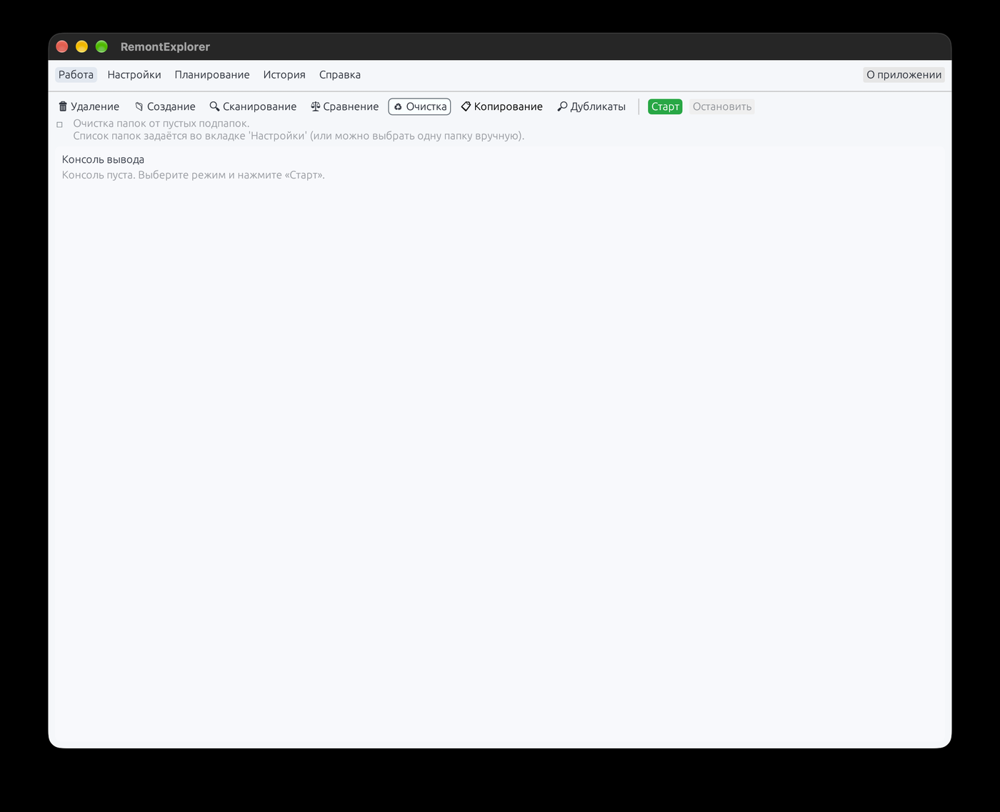
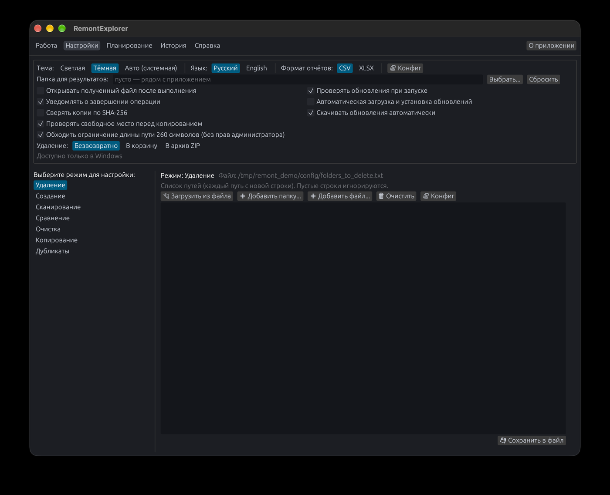
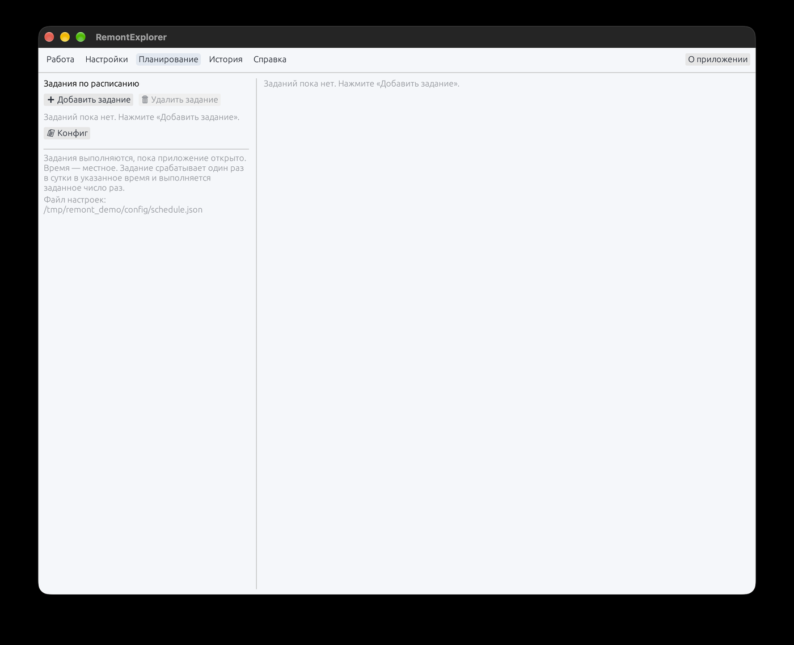
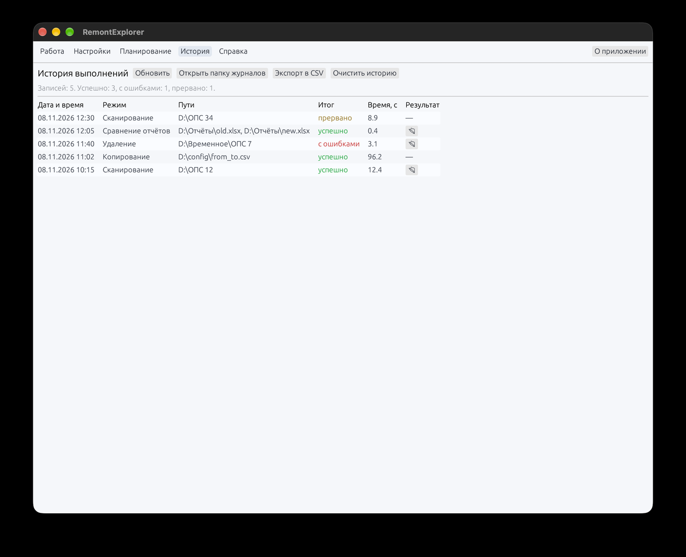
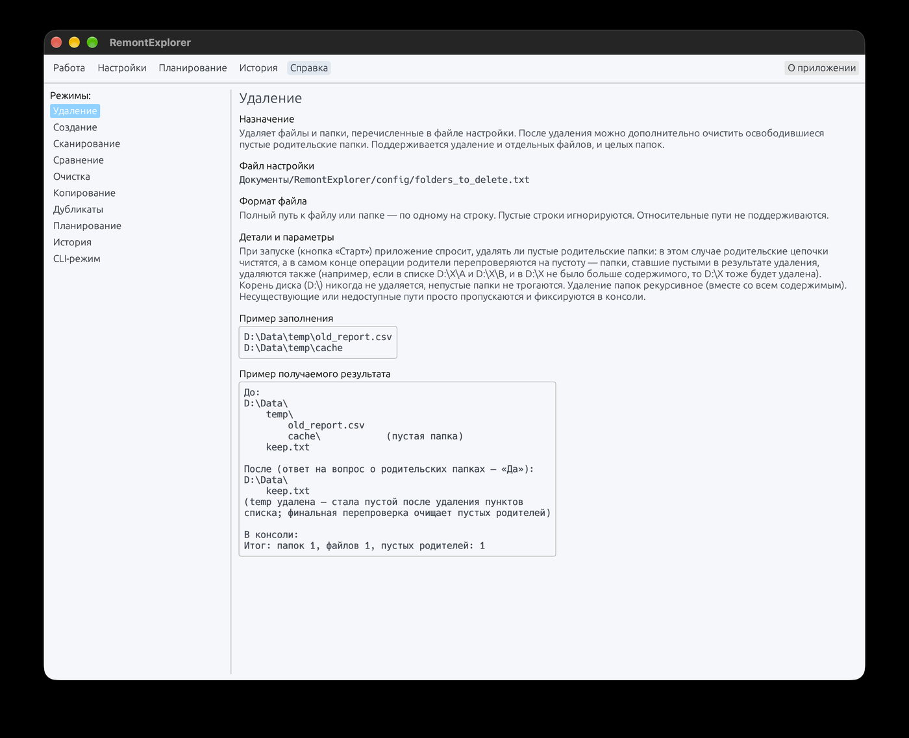

# RemontExplorer

Приложение для файловых операций: сканирование папок, сравнение, копирование,
удаление, очистка, поиск дубликатов и архивирование созданных папок.
Отчёты — CSV/XLSX, любые операции по расписанию.

Автор: Иван Евсеев (Ivan Evseev) — Telegram [@ivanevseev1](https://t.me/ivanevseev1),
GitHub [@IntruderHere](https://github.com/IntruderHere).



## Содержание

- [История](#история)
- [Возможности](#возможности)
- [Установка и расположение файла](#установка-и-расположение-файла)
- [Интерфейс](#интерфейс)
- [Режимы работы](#режимы-работы)
- [Что нового в 2.3.2](#что-нового-в-232)
- [Автоматическое обновление](#автоматическое-обновление)
- [Обновления без GitHub](#обновления-без-github)
- [Командная строка](#командная-строка)
- [Где лежат настройки и отчёты](#где-лежат-настройки-и-отчёты)
- [Сборка](#сборка)

## История

Приложение родилось как попытка переписать [DirLister](https://github.com/SanderSade/DirLister)
(SanderSade, C#/.NET) на Python. Впоследствии переписано на Rust — с помощью моделей
Qwen 3.6 35B A3B и Deepseek V 4.1 Flash 1017.

Сделано из-за никчёмной серверной части корпоративных систем АО «Почта России»:
чтобы упростить жизнь и автоматизировать работу с файлами.

Разработчик: Иван Евсеев — Telegram [@ivanevseev1](https://t.me/ivanevseev1),
GitHub [@IntruderHere](https://github.com/IntruderHere).

## Возможности

- **Сканирование** — инвентаризация файлов в CSV (UTF-8 с BOM, `;`, открывается в Excel)
  или XLSX; параллельный обход дерева, колонка `index_ops` с номером объекта.
  Два состава отчёта (переключатель в настройках): **только файлы** — папки без
  файлов в выгрузку не попадают; **файлы и папки** — в отчёт идут все пути,
  включая пустые папки, с колонкой `type` (`file` / `dir`).
- **Сравнение** — две папки по именам файлов: размер/дата, побайтово, SHA-256, MD5.
- **Длинные пути** — обход ограничения 260 символов через префикс `\\?\` (флажок в
  настройках; права администратора не нужны). Системную поддержку (`LongPathsEnabled`)
  можно включить оттуда же одной кнопкой — Windows запросит подтверждение UAC.
- **Копирование** — по списку «откуда;куда», длинные пути Windows (`\\?\`),
  возобновление после прерывания, 16 потоков, проверка доступности SMB.
- **Удаление** — по списку, с очисткой освободившихся пустых родительских папок.
- **Создание** — структура папок из списка, при необходимости ZIP + удаление оригиналов.
- **Очистка** — удаление пустых вложенных папок.
- **Дубликаты** — двухфазный поиск (размер → хеш), отчёт по группам.
- **Планирование** — задания «функция + время + число выполнений + папка результата».
- Интерфейс: светлая/тёмная/системная тема, русский и английский язык,
  сворачивание в трей, пункт в контекстном меню Проводника, автозапуск с Windows,
  проверка обновлений на GitHub.

## Установка и расположение файла

**Установка не требуется.** Приложение — один `remont_explorer.exe`, без инсталлятора,
без служб, без DLL рядом и без записей в системе при первом запуске.
Достаточно распаковать архив и запустить файл.

**Права администратора не нужны.** Всё, что приложение меняет за пределами
выбранных вами папок, лежит в профиле пользователя:

- настройки, журналы, история — `Документы\RemontExplorer`;
- пункт контекстного меню Проводника и автозапуск — ветки `HKEY_CURRENT_USER`
  (это разрешено обычному пользователю);
- ярлык и файлы обновления — во временной папке пользователя.

### Рекомендуемый путь

```
C:\Users\<имя пользователя>\RemontExplorer\remont_explorer.exe
```

То же самое через переменные окружения:

```
%USERPROFILE%\RemontExplorer\remont_explorer.exe
```

Подойдёт и `%LOCALAPPDATA%\Programs\RemontExplorer\remont_explorer.exe` —
это стандартное место для приложений, установленных «для одного пользователя».

**Не размещайте файл в `C:\Program Files`, `C:\Program Files (x86)` и других
защищённых каталогах.** Приложение там запустится, но автоматическое обновление
не сможет заменить exe без прав администратора. Если файл всё же лежит в защищённой
папке, приложение сообщит об этом и не закроется.

Рядом с exe ничего не создаётся — папку можно использовать как переносимую:
скопировали каталог целиком, настройки при этом останутся в профиле.

## Интерфейс

Пять вкладок: **Работа**, **Настройки**, **Планирование**, **История**, **Справка**.
Вкладки переключаются мышью; полностью описаны также во встроенной справке (там же
примеры заполнения конфигов и вывода).

### Работа

Сверху — кнопки режимов, «Старт» и «Остановить», ниже — описание выбранного режима,
прогресс и консоль. Операция выполняется в отдельном потоке: интерфейс не подвисает,
«Остановить» прерывает работу на ближайшей проверке.

### Настройки

Общие настройки (тема, язык, формат отчётов, папка результатов, поведение, обновления)
и, ниже, редактор конфигурации выбранного режима: список путей или пары «откуда;куда».
Файлы можно править прямо в окне и сохранять кнопкой «Сохранить в файл».



### Планирование

Задание = функция + время + число выполнений + папка результата. Планировщик проверяет
время раз в секунду; если компьютер был выключен, задание догоняется в течение 30 минут
после запуска приложения. Исчерпавшие лимит задания отключаются автоматически.



### История

Журнал всех выполнений: время, режим, пути, длительность, итог и кнопка открытия
результата. Заполняется автоматически — в том числе для заданий расписания и запусков
из командной строки. Есть экспорт в CSV и очистка.



### Справка

По каждому режиму: назначение, файл настройки, формат, детали, примеры заполнения и
результата. Отдельные разделы — «История» и «CLI-режим».



## Режимы работы

| Режим | Назначение |
|---|---|
| **Удаление** | Удаляет файлы и папки, перечисленные в файле настройки |
| **Создание** | Создаёт структуру папок из списка |
| **Сканирование** | Строит инвентаризацию файлов в одной или нескольких папках и сохраняет результат в CSV-отчёт |
| **Сравнение** | Сравнивает содержимое двух папок и находит различия: файлы, присутствующие только в A, только в B, изменённые (различаются по размеру или дате) и идентичные |
| **Очистка** | Удаляет пустые вложенные папки в указанных каталогах |
| **Копирование** | Копирует файлы и папки по списку пар «откуда;куда» |
| **Дубликаты** | Находит файлы с одинаковым содержимым в указанных папках и группирует их |
| **Планирование** | Автоматически выполняет любую функцию приложения по расписанию — без участия пользователя |

### Удаление

**Что делает.** Удаляет файлы и папки, перечисленные в файле настройки. После удаления можно дополнительно очистить освободившиеся пустые родительские папки. Поддерживается удаление и отдельных файлов, и целых папок.

**Файл настройки:** `Документы/RemontExplorer/config/folders_to_delete.txt`

**Формат файла.** Полный путь к файлу или папке — по одному на строку. Пустые строки игнорируются. Относительные пути не поддерживаются.

**Детали.** При запуске (кнопка «Старт») приложение спросит, удалять ли пустые родительские папки: в этом случае родительские цепочки чистятся, а в самом конце операции родители перепроверяются на пустоту — папки, ставшие пустыми в результате удаления, удаляются также (например, если в списке D:\X\A и D:\X\B, и в D:\X не было больше содержимого, то D:\X тоже будет удалена). Корень диска (D:\) никогда не удаляется, непустые папки не трогаются. Удаление папок рекурсивное (вместе со всем содержимым). Несуществующие или недоступные пути просто пропускаются и фиксируются в консоли.

**Пример заполнения:**

```text
D:\Data\temp\old_report.csv
D:\Data\temp\cache
```

**Пример результата:**

```text
До:
D:\Data\
    temp\
        old_report.csv
        cache\            (пустая папка)
    keep.txt

После (ответ на вопрос о родительских папках — «Да»):
D:\Data\
    keep.txt
(temp удалена — стала пустой после удаления пунктов
списка; финальная перепроверка очищает пустых родителей)

В консоли:
Итог: папок 1, файлов 1, пустых родителей: 1
```

### Создание

**Что делает.** Создаёт структуру папок из списка. Все промежуточные родительские уровни, которых ещё нет, также создаются автоматически.

**Файл настройки:** `Документы/RemontExplorer/config/folders_to_create.txt`

**Формат файла.** Полный путь к папке — по одному на строку.

**Детали.** Подсчитываются и создаются все родительские уровни (не только целевая папка), поэтому полный путь разворачивается за один шаг. После создания спросит, упаковать ли созданные папки в ZIP-архив и удалить оригиналы. Архив получает имя created_folders_<дата>.zip и сохраняется в папке приложения.

**Пример заполнения:**

```text
D:\Проекты\2024\Отчёт
D:\Проекты\2024\Документы\Счета
```

**Пример результата:**

```text
До: папка D:\Проекты\ отсутствует.

После:
D:\Проекты\
    2024\
        Отчёт\
        Документы\
            Счета\

В консоли:
Создана папка: D:\Проекты
Создана папка: D:\Проекты\2024
Создана папка: D:\Проекты\2024\Отчёт
Создана папка: D:\Проекты\2024\Документы
Создана папка: D:\Проекты\2024\Документы\Счета
Создано папок (включая родительские): 5

При ответе «Да» на вопрос об архиве дополнительно
создаётся created_folders_<дата>.zip со всей
созданной структурой (оригиналы при этом удаляются).
```

### Сканирование

**Что делает.** Строит инвентаризацию файлов в одной или нескольких папках и сохраняет результат в CSV-отчёт.

**Файл настройки:** `Документы/RemontExplorer/config/folder_to_list.txt`

**Формат файла.** Список папок — по одной на строку. Если список пуст, можно выбрать одну папку в диалоге.

**Детали.** Если список задан — все папки обрабатываются пакетом в один файл BATCH_SCAN_<дата>.csv. Колонки: source_root (корень сканирования), full_path (полный путь), parent_dir, name (имя файла), extension (расширение), size_mb (размер в МБ с двумя знаками), index_ops (первая 6-значная последовательность в пути — удобно для извлечения номеров объектов). Обход дерева выполняется параллельно заданным потоками; количество потоков задаётся на вкладке «Настройки» → «Сканирование» (по умолчанию — число ядер процессора). CSV: UTF-8 с BOM, разделитель ';' — открывается в Excel (RU) без дополнительной настройки. Отчёт сохраняется в CSV; в настройках можно выбрать формат XLSX — тогда CSV автоматически конвертируется в книгу Excel и удаляется.

**Пример заполнения:**

```text
D:\Data\123456
```

**Пример результата:**

```text
Создаётся файл отчёта:
files_info_123456_20261025_143000.csv
(UTF-8 с BOM, разделитель ';' — открывается в Excel):

source_root;full_path;parent_dir;name;extension;size_mb;index_ops
D:\Data\123456;D:\Data\123456\photo.jpg;D:\Data\123456;photo.jpg;jpg;3.21;123456
D:\Data\123456;D:\Data\123456\readme.txt;D:\Data\123456;readme.txt;txt;0.01;

Колонка index_ops — первое вхождение ровно 6 цифр
в полном пути (здесь 123456 из имени папки);
если таких нет, колонка пустая.

В консоли:
[START] Сканирование: D:\Data\123456
[DONE] Готово. Файлов: 2. Отчет: files_info_123456_20261025_143000.csv
```

### Сравнение

**Что делает.** Сравнивает содержимое двух папок и находит различия: файлы, присутствующие только в A, только в B, изменённые (различаются по размеру или дате) и идентичные.

**Файл настройки:** `Документы/RemontExplorer/config/folders_to_compare.txt`

**Формат файла.** Пары «папка A;папка B» — по одной паре на строку. Количество заполненных строк в обеих колонках должно совпадать: при сохранении приложение попросит подтверждение, если пары неполные.

**Детали.** Четыре метода сравнения (выбираются в диалоге при запуске): «Только размер и дата» — самый быстрый, не читает содержимое файлов; «Побайтовое сравнение» — точное совпадение содержимого; «Хеш SHA-256» — точное, по хешу файла; «Хеш MD5» — быстрее, но менее надёжен. В отчёт compare_*.csv выносится классификация каждого файла. Отчёт сохраняется в CSV; в настройках можно выбрать формат XLSX — тогда CSV автоматически конвертируется в книгу Excel и удаляется.

**Пример заполнения:**

```text
D:\Backup\2024-01;D:\Current\2024-01
E:\Медиа\Исходники;F:\Копия\Исходники
```

**Пример результата:**

```text
Создаётся файл отчёта:
compare_2024-01_vs_2024-01_20261025_143000.csv
(UTF-8 с BOM, разделитель ';'):

file_name;path_in_a;path_in_b;size_a_mb;size_b_mb;modified_a;modified_b;different
report.pdf;D:\Backup\2024-01\report.pdf;D:\Current\2024-01\report.pdf;1.20;1.20;2024-01-05T10:00:00;2024-01-05T10:00:00;No
notes.docx;D:\Backup\2024-01
otes.docx;N/A;0.80;;2024-01-10T12:00:00;;Yes
photo.jpg;D:\Backup\2024-01\photo.jpg;D:\Current\2024-01\photo.jpg;2.10;2.10;2024-01-02T09:30:00;2024-01-02T09:30:00;No

different = Yes — файл отличается (есть только в одной
из папок либо размер/дата/содержимое не совпадают);
different = No — файлы идентичны.
path_in_b = N/A — файла нет в папке B.

В консоли:
=== Сравнение D:\Backup\2024-01 <--> D:\Current\2024-01 ===
Всего уникальных имён файлов: 3
Отчёт сохранён: compare_2024-01_vs_2024-01_20261025_143000.csv
Статистика: всего записей=3, отличаются=1
```

### Очистка

**Что делает.** Удаляет пустые вложенные папки в указанных каталогах. Дерево обрабатывается одним проходом снизу вверх.

**Файл настройки:** `Документы/RemontExplorer/config/folders_to_cleanup.txt`

**Формат файла.** Список папок — по одной на строку. Если пуст, можно выбрать папку в диалоге.

**Детали.** Удаляются только действительно пустые папки — папки с файлами (включая скрытые) не трогаются. Родительская папка, ставшая пустой только после удаления дочерних, в этом же проходе НЕ удаляется (та же логика при повторном запуске) — при необходимости запустите режим повторно. Для списка из нескольких папок выполняется последовательная очистка, итоги суммируются.

**Пример заполнения:**

```text
D:\Data\EmptyTree
E:\Temp\Subfolders
```

**Пример результата:**

```text
До:
D:\Data\EmptyTree\
    a\
        b\              (пустая)
    c\                  (пустая)
    d.txt               (файл — не трогается)

После:
D:\Data\EmptyTree\
    a\                  (осталась: в момент обхода
                         содержала папку b)
    d.txt

В консоли:
Найдено пустых папок: 2
Удалена пустая папка: D:\Data\EmptyTree\a\b
Удалена пустая папка: D:\Data\EmptyTree\c
```

### Копирование

**Что делает.** Копирует файлы и папки по списку пар «откуда;куда». Поддерживает длинные пути Windows, возобновление после прерывания и 16 параллельных потоков.

**Файл настройки:** `Документы/RemontExplorer/config/from_to.csv`

**Формат файла.** CSV: пары «исходник;назначение» — по одной паре на строку. Исходник — копируемый файл или папка, назначение — куда его копировать.

**Детали.** 16 рабочих потоков. Длинные пути обрабатываются префиксом \\?\ (обход ограничения Windows в 260 символов). Кэш возобновления — config/from_to.resume.json: при повторном запуске после прерывания спросит, пропустить ли уже скопированные файлы. Копирование атомарное (временный файл + rename) — не останется «половинчатых» файлов. Итоги выводятся в консоль.

**Пример заполнения:**

```text
D:\Src\a.txt;E:\Dst\a.txt
D:\Src\folder;E:\Dst\folder
```

**Пример результата:**

```text
До:
D:\Src\
    a.txt
    folder\
        inner.txt
E:\Dst\             (отсутствует)

После (размер и содержимое совпадают):
E:\Dst\
    a.txt
    folder\
        inner.txt

В консоли:
Начинаю копирование 2 файлов (потоков: 16)...
[PROGRESS] Скопировано 2 из 2...
Готово. Успешно скопировано: 2 из 2

Повторный запуск после прерывания (кэш возобновления):
Пропущено уже скопированных файлов (из кэша): 2
Нет новых задач копирования.
```

### Дубликаты

**Что делает.** Находит файлы с одинаковым содержимым в указанных папках и группирует их.

**Файл настройки:** `Документы/RemontExplorer/config/folders_to_duplicates.txt`

**Формат файла.** Список папок — по одной на строку; анализируются как единое множество. Если пуст, можно выбрать папку в диалоге.

**Детали.** Двухфазный поиск: сначала группировка по размеру файла (дешёвый фильтр, отбрасывающий заведомо разные файлы), затем хеширование только тех, что совпали по размеру. Алгоритм хеша выбирается в диалоге: SHA-256 (точнее) или MD5 (быстрее). В отчёт duplicates_*.csv выносятся группы дубликатов с общим размером и хешем. Отчёт сохраняется в CSV; в настройках можно выбрать формат XLSX — тогда CSV автоматически конвертируется в книгу Excel и удаляется.

**Пример заполнения:**

```text
D:\Data\All
E:\Медиа
```

**Пример результата:**

```text
Создаётся файл отчёта:
duplicates_All_20261025_143000.csv
(по одной строке на каждый файл группы):

group_id;full_path;size_bytes;hash
1;D:\Data\All\a.jpg;3355443;sha256:ab12cd34ef56...
1;D:\Data\All\copy_a.jpg;3355443;sha256:ab12cd34ef56...
1;D:\Data\All\scan (2).jpg;3355443;sha256:ab12cd34ef56...

Файлы с одинаковым group_id и hash — дубликаты
(3 файла с идентичным содержимым). Уникальные
файлы в отчёт не попадают.

В консоли:
Папки для анализа: 2
Найдено файлов: 5. Группировка по размеру...
Вычисление SHA-256-хешей...
Найдено групп дубликатов: 1
Группа 1: 3 файлов, размер 3355443 bytes
Отчёт сохранён: duplicates_All_20261025_143000.csv
```

### Планирование

**Что делает.** Автоматически выполняет любую функцию приложения по расписанию — без участия пользователя. Задания работают, пока приложение открыто.

**Файл настройки:** `Документы/RemontExplorer/config/schedule.json`

**Формат файла.** Настраивается на вкладке «Планирование» и хранится в config/schedule.json (JSON) рядом с приложением. Править файл вручную не требуется.

**Детали.** Задание состоит из четырёх частей: функция (любой из семи режимов), время суток ЧЧ:ММ, количество выполнений и папка для сохранения результата. Задание срабатывает один раз в сутки в указанное время и выполняется ровно заданное число раз, после чего автоматически отключается — счётчик «Осталось выполнений» виден в редакторе. Если приложение было закрыто в момент запуска, задание сработает при старте, но не позже чем через 30 минут после назначенного времени (окно «догона»); позже оно считается пропущенным до следующего дня. Параметры режимов по умолчанию: удаление — с очисткой освободившихся пустых родителей; создание — без упаковки в ZIP; сканирование — пакетно в один файл; сравнение — «только размер и дата»; копирование — с пропуском уже скопированных файлов; дубликаты — SHA-256. Отчёты (сканирование, сравнение, дубликаты) сохраняются в указанную папку; остальные режимы отчётов не создают. Кнопка «Выполнить сейчас» запускает задание немедленно, не дожидаясь времени (одно выполнение при этом списывается). Если в момент запуска уже идёт другая операция, задание ожидает её завершения.

**Пример заполнения:**

```text
Функция: Сканирование
Время: 23:30
Количество выполнений: 30
Папка результата: D:\Отчёты\Инвентаризация
```

**Пример результата:**

```text
В консоли:
Планировщик: запуск задания «Сканирование» (2026-11-06 23:30)
[START] Сканирование: D:\Data\123456
[DONE] Готово. Файлов: 1250. Отчет: D:\Отчёты\Инвентаризация\BATCH_SCAN_20261106_233000.csv
Планировщик: задание «Сканирование» завершено. Осталось выполнений: 29

В списке заданий у строки видно время и остаток:
Сканирование  (23:30, 29)
```

## Что нового в 2.3.2

Крупное обновление после 2.0.2 — добавлены новые функции и исправлены найденные ошибки.

**Новое**

- **История выполнений** — вкладка с журналом всех операций и экспортом в CSV.
- **Сравнение отчётов** — дельта между двумя отчётами сканирования (CSV или XLSX):
  что появилось, что исчезло, что изменилось по размеру.
- **Удаление в корзину или через ZIP-архив** — вместо только безвозвратного удаления.
- **Сверка копирования по SHA-256** и **проверка свободного места** перед копированием и архивацией.
- **Уведомления Windows** о завершении операции.
- **Командная строка** — все режимы без окна (см. [Командная строка](#командная-строка)).
- **Автообновление** — фоновая загрузка релиза и установка с перезапуском.
- **Тёмный заголовок окна** под тёмную тему.

**Исправлено**

- Не открывался файл результата с кириллицей в имени (теперь ShellExecute и абсолютный путь).
- Два отчёта, созданные в одну секунду, затирали друг друга (добавляется суффикс `_2`).
- Не открывалась папка журналов (путь с префиксом `\\?\`).
- Приложение в каталоге только для чтения не могло сохранить отчёт — теперь есть резервная папка.
- Интерфейс: убраны синий текст, двойные линии и «прыгающие» отступы; флажки выровнены.

## Автоматическое обновление

При запуске приложение проверяет релизы на GitHub. Если версия новее:

- архив `RemontExplorer-windows-x64.zip` скачивается в фоне (прогресс виден в «О приложении»);
- затем предлагается «Обновить и перезапустить» — приложение закрывается,
  заменяет свой exe и запускается заново с сохранёнными настройками.

В настройках есть два флажка:

- **Скачивать обновления автоматически** — загрузка начинается сразу после обнаружения;
- **Автоматическая загрузка и установка обновлений** — приложение само ставит обновление
  (установка откладывается, если в этот момент выполняется операция).

Если API GitHub недоступен, ссылка на архив строится по шаблону релиза, поэтому
обновление работает и в сетях, где `api.github.com` закрыт.

## Обновления без GitHub

В корпоративной сети GitHub может быть недоступен (API не отвечает, сертификат
подменяется прокси). Тогда обновления берутся из своего источника — сетевой папки,
внутреннего веб-сервера или зеркала репозитория.

**Как настроить**

1. Положите архив `RemontExplorer-windows-x64.zip` в доступное место:
   `\\server\share\RemontExplorer\` или на внутренний HTTP-сервер.
2. Соберите рядом манифест `update.json`:

   ```bash
   python tools/make_update_json.py --version 2.5.0 \
       --zip RemontExplorer-windows-x64.zip \
       --base '\\server\share\RemontExplorer' \
       --out '\\server\share\RemontExplorer\update.json'
   ```

3. В приложении: **Настройки → Источник обновлений** — укажите папку,
   `update.json` или URL манифеста. Пустое поле означает GitHub.

**Формат манифеста**

```json
{
  "version": "2.5.0",
  "url": "\\\\server\\share\\RemontExplorer\\RemontExplorer-windows-x64.zip",
  "sha256": "f95398d4b4040a2181c826ac9b70b83148533a484d0ea90888ae7b758f106855",
  "notes": "что нового"
}
```

Поддерживается `http(s)://`, `file://`, UNC-путь (`\\server\share`) и обычный путь.
Если указан `sha256`, приложение сверяет архив перед установкой и не ставит
повреждённый или подменённый файл.

**Варианты, где держать обновления**

| Вариант | Когда подходит |
|---|---|
| Сетевая папка (SMB) | есть общий диск, нет интернета — самый простой путь |
| Внутренний HTTP (nginx, IIS, Nexus, Artifactory) | нужен один адрес для всех |
| Российские хостинги (GitFlic, GitVerse, SourceCraft) | нужен публичный адрес, GitHub заблокирован |
| Зеркало GitHub-прокси | не рекомендуется: нестабильны и не гарантируют целостность |

## Командная строка

```
remont_explorer.exe --cli --scan "D:\ОПС" --out "D:\Отчёты" --format xlsx
# то же, но в отчёт попадут и папки (включая пустые), колонка type
remont_explorer.exe --cli --scan "D:\ОПС" --dirs
remont_explorer.exe --cli --copy D:\config\from_to.csv --verify
remont_explorer.exe --cli --delete D:\config\folders_to_delete.txt --recycle
remont_explorer.exe --cli --diff old.xlsx new.xlsx --out "D:\Отчёты"
remont_explorer.exe --cli --history --export D:\history.csv
```

Коды возврата: `0` — успех, `1` — операция с ошибками, `2` — неверные аргументы.

Открыть приложение сразу на нужной вкладке (без консольного режима):
`remont_explorer.exe --tab settings|schedule|history|help|work`.
Полная справка: `remont_explorer.exe --help`.

## Сборка

Требуется Rust и (для Windows-кросс-сборки с macOS/Linux) `mingw-w64`.

```bash
# на Windows
cargo build --release

# кросс-сборка под Windows x64
rustup target add x86_64-pc-windows-gnu
cargo build --release --target x86_64-pc-windows-gnu
```

Готовый файл: `target/x86_64-pc-windows-gnu/release/remont_explorer.exe`.

## Тесты

```bash
cargo test --workspace
cargo clippy --workspace --all-targets
```

## Где лежат настройки

Конфигурация хранится в профиле пользователя, а не рядом с `exe`:

```
%USERPROFILE%\Documents\RemontExplorer\config\
├── ui.json            тема, язык, формат отчётов, папка результатов
├── schedule.json      задания планировщика
├── scan_threads.txt
└── folders_to_*.txt, folder_to_list.txt, from_to.csv
```

## Проверка обновлений

Приложение обращается к
`https://api.github.com/repos/IntruderHere/RemontExplorer/releases/latest`
и сравнивает тег последнего релиза с текущей версией. Если вышла новая версия,
в шапке появляется кнопка «⬆ Доступна версия X», а в окне «О приложении» —
кнопка скачивания. Проверку можно отключить в настройках.

Чтобы выпустить обновление: создайте релиз с тегом вида `v2.1.0`
(и, при желании, приложите собранный `remont_explorer.exe`).

## Структура

```
core/   библиотека операций (без GUI)
gui/    интерфейс на egui/eframe: вкладки, настройки, планировщик, трей
```
